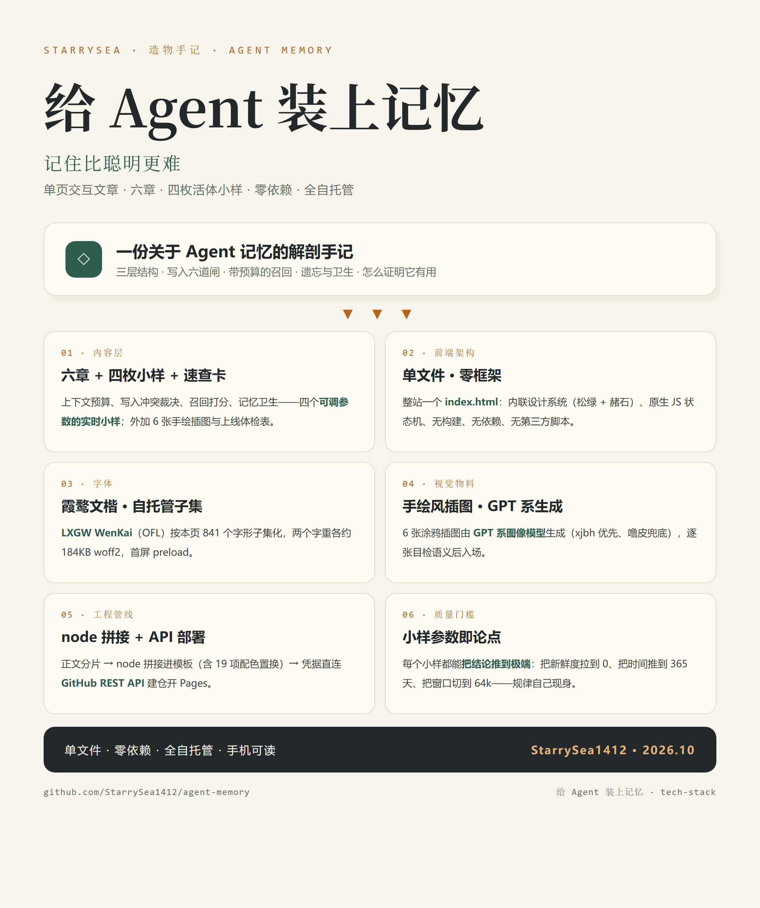

# 给 Agent 装上记忆 · 造物手记

上下文不是记忆，塞进去不是记住，记得多也不是记得好。这篇文章把自己的一整套文件式记忆系统当实验品，拆开六个部件：三层结构、写入六道闸、带预算的召回、遗忘与卫生、以及怎么证明它有用。

**[打开这一页 →](https://starrysea1412.github.io/agent-memory/)**

六章正文 + **四枚可调参数的实时小样**（上下文预算 / 写入冲突 / 召回打分 / 记忆卫生）+ 速查卡 + 上线体检表，6 张手绘插图。

> 文中小样为原生 DOM 实现，参数即时生效；字体为霞鹜文楷（OFL）子集化自托管；插图为 GPT 系图像模型生成。

---

单页站点由 `index.html` 单文件承载（零构建、零依赖）。
